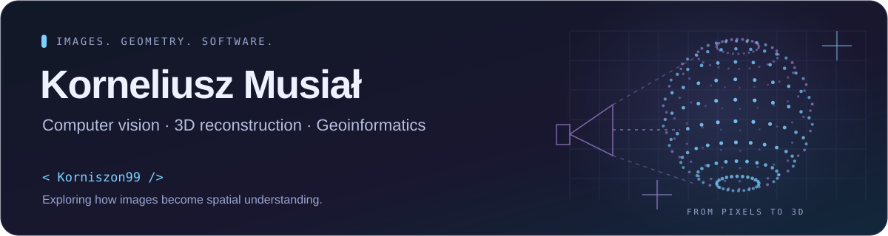

## Hey, I'm Kornel 👋

I build things where **images, geometry and software** meet. 
My direction: **computer vision & AI**, with a focus on **3D reconstruction** and **spatial data**.

---

## 💫 A little about me

🧭 **Geoinformatics background** at Warsaw University of Technology. 
🔭 **Currently exploring** neural scene representations and the geometry behind them. 
🛠️ **Connecting the pieces** — from image acquisition and spatial data to APIs and usable interfaces. 
🌱 **Next step:** reproducible NeRF / Gaussian splatting comparisons, with visual results and a clear evaluation setup.

## 💻 My toolkit

**Languages & foundations**

**Backend & spatial data**

**Apps, cloud & tools**

✏️ A few more tools

 

## 🧠 Projects in focus

### 🌌 [NeRF vs Gaussian Splatting](https://github.com/Korniszon99/nerf_vs_gaussian)

A research workbench for **neural scene reconstruction**: datasets, camera poses, training runs, logs and reconstruction artifacts in one place.

*Research prototype · held-out comparison results are the next milestone.*

### 🛰️ [Photogrammetric Flight Planner](https://github.com/Korniszon99/fotogrametia_projekt_nalotu)

From **camera geometry and target GSD** to image footprints, overlap and acquisition layouts — an interactive look at the data collection side of computer vision.

*Educational flat-ground planning model.*

### 🗺️ [EuroRace Backend](https://github.com/Korniszon99/eurorace_backend)

A **geospatial event backend** combining spatial APIs, participant location reports, tasks and real-time updates.

*Supporting backend engineering project · deployment requirements are documented in the repository.*

🧩 More things I've been building

 

| Project | A quick look |
| --- | --- |
| [Computational Geometry](https://github.com/Korniszon99/Geometria_Obliczeniowa) | 📐 An interactive point-orientation demo |
| [PW Hub](https://github.com/Korniszon99/PW_hub_flutter) | 📱 A Flutter student information prototype |
| [SSPW Photo Task Game](https://github.com/Korniszon99/SSPWPhotoTaskGame) | 📸 Photo challenges, uploads and rankings |
| [Varsonalia Map](https://github.com/Korniszon99/varso_mapka) | 📍 Team and station workflows for a field game |
| [Azure Training](https://github.com/Korniszon99/training-azure-102026) | ☁️ Microservice deployment exercises and training organization |

---

## 📊 GitHub, at a glance

  

  

---

**From pixels to spatial understanding.** 
Computer vision · Geometry · Software engineering

